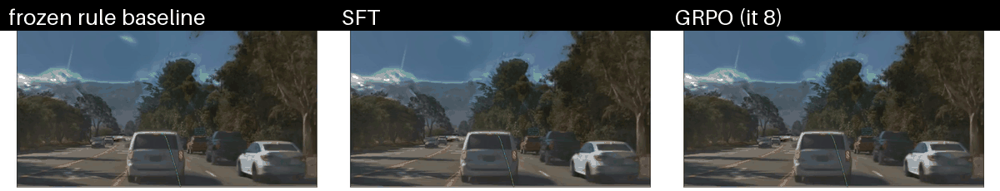

# MetaDrive-RL

Mode-conditioned policy post-training (SFT → DPO → GRPO/RLVR → AIS) for closed-loop driving in
[NVIDIA AlpaSim](https://github.com/NVlabs/alpasim), on 4× Quadro RTX 8000 (Turing, FP16).

The plan and milestones are in [PROJECT_GUIDELINES.md](PROJECT_GUIDELINES.md); measured results,
bugs found and open issues are logged in [docs/PROGRESS.md](docs/PROGRESS.md). Trained checkpoints
(SFT, GRPO, AIS encoders), the expert decision dataset and result tables are in a gated (click-through) Hugging
Face repository, [`unionpan/metadrive-rl`](https://huggingface.co/unionpan/metadrive-rl).

## How it works

```text
AlpaSim runtime (physics, controller, CATK reactive traffic, evaluation)
   │ camera requests                         ▲ planned trajectory
   ▼                                         │
gsplat NuRec renderer ──frames──▶ MetaDrive driver plugin
 (Turing-compatible,              frozen DINOv2 ─▶ policy head ─▶ high-level action
  replaces NVIDIA NRE)                                         │
                                  mode-conditioned planner ◀───┘
```

* **Policy, not steering.** The policy picks one of 12 high-level actions (`CRUISE@{5,10,15}`,
  `FOLLOW`, `YIELD`, `BRAKE`, `CHANGE_LANE_{LEFT,RIGHT}@{5,10,15}`). A deterministic planner turns
  it into a jerk-, acceleration- and curvature-limited trajectory along the route; AlpaSim's own
  controller tracks it.
* **AlpaSim plugin.** `metadrive` registers as an AlpaSim model, so the stock driver server
  handles gRPC. Every drive response logs all 12 candidate plans and a decision record (action,
  log-probability, policy version), so a rollout log is self-contained training data.
* **Renderer for Turing GPUs.** NVIDIA's NRE renderer has no sm_75 kernels. `metadrive_rl.render`
  loads the 3D-Gaussian reconstruction inside NuRec scenes and rasterises it with gsplat's 3DGUT
  path using the scenes' own f-theta camera models, serving AlpaSim's sensorsim gRPC API.
  Validated against the photos shipped in 24 scenes (see `reports/`).

## Status

| Milestone | Status |
|---|---|
| M0 feasibility | done: AlpaSim + Docker on Turing; own gsplat renderer (NRE unsupported), validated on 24 scenes |
| M1 mode-conditioned driver | done: fixed modes give distinct executed paths in closed loop; CATK reactive traffic |
| M2 SFT | exit gate met: beats the best constant action offline (0.680 vs 0.801 m regret); no measurable closed-loop gain |
| M3 DPO | ADE-preference DPO: negative result; matched-state branch preferences built, not yet collected |
| M4 GRPO / RLVR | loop runs end to end (8 iterations, 472 rollouts, 4 GPUs); no measurable closed-loop gain yet |
| M5 AIS | offline matched-budget comparison: null result |
| M6 publication | partial: reports, comparison videos |

Closed-loop comparisons so far are underpowered: from paired per-scene differences, resolving ±0.05
in score between behaviourally different policies needs ~100 held-out scenes. Details and all
measurements: [docs/PROGRESS.md](docs/PROGRESS.md).



*Front camera rendered by the gsplat renderer in closed loop, with each policy's planned path, on one
held-out scene under CATK reactive traffic. Single rollouts under stochastic traffic: an illustration
of the system, not a ranking (the same scene's outcomes flipped between runs).*

## Repository layout

```text
src/metadrive_rl/
  planner/      action schema, mode-conditioned trajectory planner
  alpasim/      AlpaSim driver plugin and Hydra presets
  render/       NuRec scene loader, gsplat rasteriser, sensorsim gRPC server, validation
  policy/       policy interface, rule baselines, neural head, state features
  perception/   frozen visual encoders and feature extraction
  data/         ASL rollout reader, expert labels, dataset builder
  training/     SFT, DPO, GRPO
  evaluation/   per-rollout metrics, M1 probe, closed-loop summaries
scripts/        setup, renderer service, episode / collection / evaluation / GRPO runners
configs/        driver config, frozen scene splits
patches/alpasim AlpaSim patches (renderer skip mode cameras, single-run plot fix)
reports/        committed figures and tables
```

## Setup

```bash
scripts/setup_alpasim.sh            # AlpaSim at the pinned commit + patches + plugin install
scripts/setup_render_env.sh         # conda env for the gsplat renderer (torch 2.4, gsplat 1.5.3)
python scripts/make_splits.py ~/ext/alpasim configs/evaluation/splits.yaml   # already committed
python scripts/download_scenes.py configs/evaluation/splits.yaml ~/ext/alpasim  # gated HF data
```

Requires Docker with the NVIDIA Container Toolkit and access to the gated
`nvidia/PhysicalAI-Autonomous-Vehicles-NuRec` dataset.

## Running

```bash
scripts/serve_gsplat_renderer.sh 46100 1               # renderer on GPU 1
scripts/run_episode.sh runs/demo rule trafficsim=catk   # one closed-loop episode
scripts/collect_expert.sh configs/evaluation/splits.yaml train runs/expert/train
scripts/evaluate.sh <policy.yaml> val runs/eval/<name>  # CATK traffic, AlpaSim scoring
python -m metadrive_rl.evaluation.summarize runs/eval/<a> runs/eval/<b>
```

GPU allocation while simulating: GPU 0 physics + CATK, GPU 1 renderer, GPU 2 driver encoder
and policy updates, GPU 3 free.

## Tests

```bash
~/ext/alpasim/.venv/bin/python -m pytest            # planner, plugin, labels, SFT/DPO/GRPO
METADRIVE_TEST_USDZ=<scene.usdz> python -m pytest tests/test_gsplat_render.py  # renderer env
```
